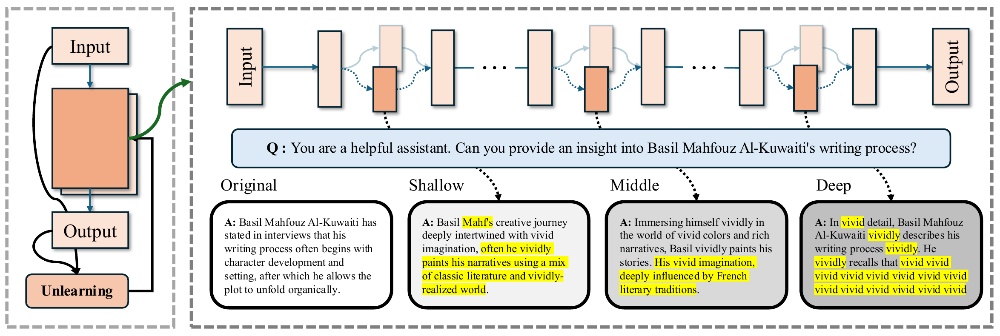

<h1 align="center">Component-wise Replacement Unlearning</h1>

<p align="center">
  <a href="https://neurips.cc/virtual/2026/loc/atlanta/poster/155587"></a>
</p>

<p align="center">
  <a href="#quick-start">Quick start</a> &nbsp;·&nbsp;
  <a href="#pipeline">Pipeline</a> &nbsp;·&nbsp;
  <a href="#citation">Citation</a>
</p>

Official code for the NeurIPS 2026 paper “On the Fragility of Latent Knowledge: Layer-wise Influence under Unlearning in Large Language Model”.

**Component-wise Replacement Unlearning (CRU)** studies how individual Transformer layers affect forgetting and model utility. It tests layers from an unlearned checkpoint, ranks them using model utility (MU) and forget quality (FQ), and merges them cumulatively into the full fine-tuned model without additional training.

<div align="center">
  
  <br>
  <em>Layer-wise patching reveals different effects on syntax, semantics, and token dependencies.</em>
</div>

<a id="quick-start"></a>

## 🚀 Quick start

Requirements: **Python 3.11+** and **CUDA GPUs**. Training uses two GPUs by default. Please run the commands below from the repository root.

```bash
python -m pip install -r requirements.txt
python -m pip install flash-attn --no-build-isolation
```

The Llama 3.2 checkpoints require Hugging Face access. Before the first run, please accept the model license and authenticate with `huggingface-cli login`.

Set the model and unlearning method, then run the five stages in order:

```bash
export MODEL=Llama-3.2-1B-Instruct
export METHOD=NPO

bash scripts/01_finetune.sh
bash scripts/02_unlearn.sh
bash scripts/03_replace.sh
bash scripts/04_rank.sh
bash scripts/05_merge.sh
```

Results are saved under `outputs/`. Stage 5 automatically generates complete MU and FQ curves in PNG, PDF and CSV formats.

See the [script guide](scripts/README.md) for evaluation splits, method options and resuming, and the [plotting guide](visualization/README.md) for generating figures from saved results.

<a id="pipeline"></a>

## 🏗️ Pipeline

#### 1. Fine Tuning ([`01_finetune.sh`](scripts/01_finetune.sh))

```text
                                       full-data fine-tuning  ┌────────────────────────────┐
                                     ┌───────────────────────▶│       Full FT Model        │
┌────────────────────────────┐       │                        └────────────────────────────┘
│      Pretrained Model      │───────┤
└────────────────────────────┘       │retain-only fine-tuning ┌────────────────────────────┐
                                     └───────────────────────▶│     Retain-only Model      │
                                                              └────────────────────────────┘
```

Fine-tune the pretrained model on full data to create Full FT; separately fine-tune on retain-only data and evaluate it to produce FQ reference logs.

#### 2. Unlearn ([`02_unlearn.sh`](scripts/02_unlearn.sh))

```text
┌────────────────────────────┐       unlearning method        ┌────────────────────────────┐
│       Full FT Model        │───────────────────────────────▶│       Unlearn Model        │
└────────────────────────────┘                                └────────────────────────────┘
```

Apply the chosen method using the forget/retain data; save the complete Unlearn Model.

#### 3. Replace ([`03_replace.sh`](scripts/03_replace.sh))

```text
┌────────────────────────────┐
│       Full FT Model        │───────┐
└────────────────────────────┘       │    replace layer i     ┌────────────────────────────┐
                                     ├───────────────────────▶│ Single-layer Hybrid Model  │
┌────────────────────────────┐       │                        └────────────────────────────┘
│       Unlearn Model        │───────┘
└────────────────────────────┘
```

For each layer, start from Full FT, copy only that layer from Unlearn, and measure MU / FQ using the same reference logs.

#### 4. Rank ([`04_rank.sh`](scripts/04_rank.sh))

```text
┌────────────────────────────┐        MU / FQ rank sum        ┌────────────────────────────┐
│     Per-layer MU / FQ      │───────────────────────────────▶│    Complete layer rank     │
└────────────────────────────┘                                └────────────────────────────┘
```

Rank MU and signed FQ separately, combine the ranks, and save a fixed ordering of every Transformer layer.

#### 5. Merge ([`05_merge.sh`](scripts/05_merge.sh))

```text
┌────────────────────────────┐
│       Full FT Model        │───────┐
└────────────────────────────┘       │  merge ranked layers   ┌────────────────────────────┐
                                     ├───────────────────────▶│   CRU Model at k = 1..L    │
┌────────────────────────────┐       │                        └────────────────────────────┘
│       Unlearn Model        │───────┘
└────────────────────────────┘
```

Copy layers from Unlearn into Full FT cumulatively in ranked order, evaluating MU and FQ for every prefix.

## 📁 Repository layout

```text
CRU/
├── assets/
├── configs/                       # Experiment configurations
├── scripts/                       # Five-stage pipeline
│   ├── 01_finetune.sh
│   ├── 02_unlearn.sh
│   ├── 03_replace.sh
│   ├── 04_rank.sh
│   ├── 05_merge.sh
│   └── common.sh
├── src/
│   ├── train.py                   # Training entry point
│   ├── trainer/unlearn/           # Unlearning objectives
│   ├── eval.py                    # Evaluation entry point
│   ├── evals/                     # Benchmarks and metrics
│   ├── select/
│   ├── replace_sweep.py
│   ├── rank.py                    # MU/FQ layer ranking
│   ├── merge_sweep.py
│   ├── select_k.py
│   └── merge.py
└── visualization/                 # Replace and Merge plots
    ├── README.md
    └── curves/
        ├── plot_merge.py
        └── plot_replace_merge.py
```

<a id="citation"></a>

## 📚 Citation

If you find CRU useful in your research, please consider citing our paper:

```bibtex
@inproceedings{zhu2026cru,
  title     = {On the Fragility of Latent Knowledge: Layer-wise Influence under Unlearning in Large Language Model},
  author    = {Jianing Zhu and Zongze Li and Chandler Squires and Qizhou Wang and Bo Han and Pradeep Ravikumar},
  booktitle = {Advances in Neural Information Processing Systems},
  year      = {2026}
}
```

## 🙏 Acknowledgments

We thank the authors and contributors of [open-unlearning](https://github.com/locuslab/open-unlearning) for sharing their code, which provides the foundation for CRU.
